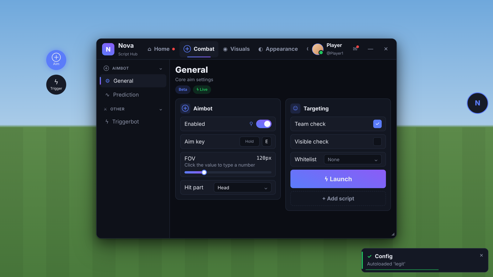

# Nova UI

Moderne, vollständig anpassbare UI-Library für Roblox-Scripts (Luau) – flüssig animiert, mobile-tauglich,
mit Live-Theme-Editor, Config-System, Loader mit Key-System, Quick-Toggles und ESP-Preview.



*HTML-Mockup des Layouts mit den Midnight-Theme-Werten – kein Roblox-Screenshot.*

> „Nova UI“ ist ein Platzhaltername. Name, Ordner-Id, Export-Präfixe und Standard-Texte werden zentral in
> [`src/Constants.lua`](src/Constants.lua) geändert.

---

## Inhalt

1. [Installation & Build](#installation--build)
2. [Schnellstart](#schnellstart)
3. [Projektstruktur](#projektstruktur)
4. [Library-API](#library-api)
5. [Loader & Key-System](#loader--key-system)
6. [Window](#window)
7. [Tabs, Kategorien, Pages, Sections](#tabs-kategorien-pages-sections)
8. [Komponenten](#komponenten)
9. [Theme-System](#theme-system)
10. [Alle Theme-Keys](#alle-theme-keys)
11. [Config-System](#config-system)
12. [Mobile](#mobile)
13. [ESP-Preview](#esp-preview)
14. [Technik & Hinweise](#technik--hinweise)

---

## Installation & Build

```lua
local UI = loadstring(game:HttpGet("https://raw.githubusercontent.com/Pander0212/UiLibrary/main/dist/NovaUI.lua"))()
```

`dist/NovaUI.lua` wird aus `src/` gebaut:

```bash
python3 tools/build.py           # bündelt src/**/*.lua -> dist/NovaUI.lua
python3 tools/build.py --check   # + Syntax-/Globals-Prüfung des Bundles
python3 tools/luau_check.py --globals=Import src/**/*.lua   # einzelne Dateien prüfen
```

Jede Datei in `src/` wird im Bundle zu einem Modul, das über `Import("Pfad/Name")` (lazy, gecacht) geladen wird.
`tools/luau_check.py` ist ein eigener Luau-Parser (inkl. Typannotationen, `continue`, Compound-Assignments,
If-Expressions, String-Interpolation), der Syntaxfehler und unbekannte Globals meldet. Wenn `luau-analyze` oder
`selene` verfügbar ist, kann das Bundle zusätzlich damit geprüft werden.

## Schnellstart

```lua
local UI = loadstring(game:HttpGet(".../dist/NovaUI.lua"))()

UI:CreateLoader({ Title = "Nova", Subtitle = "Loading..." })          -- optional, wartet bis fertig

local Win = UI:CreateWindow({ Title = "Nova", Logo = "rbxassetid://123", Theme = "Midnight" })
local Tab = Win:AddTab({ Title = "Visuals", Icon = "eye" })
local Sec = Tab:AddSection("ESP")
Sec:AddToggle({ Title = "Box", Flag = "ESP_Box", Default = false, Pinnable = true, Callback = function(v) end })

Win:AddThemeTab()    -- kompletter Appearance-Editor
Win:AddConfigTab()   -- Configs, Autoload, Export/Import, Keybind, Device-Modus
```

Ein vollständiges Beispiel mit **allen** Features liegt in [`example.lua`](example.lua).

## Projektstruktur

```
src/
  Constants.lua        Branding, Version, Strings, Sounds
  Utility.lua          Services, Create, Hex/Base64/JSON, Clipboard, GUI-Parenting, Linien, Sichtbarkeit
  Signal.lua Maid.lua  Events + Aufräum-Manager
  State.lua Gui.lua    Laufzeitzustand, ScreenGui + Layer
  Theme.lua            Schema aller Keys, Presets, Set/Reset/Serialize/Import/Export
  ThemeRegistry.lua    Bindings Instanz-Eigenschaft ⇄ Theme-Keys (animiert)
  Animations.lua       Zentraler Tween-Helper (Speed, Easing, Performance-Modus), Ripple, Shake, Bounce
  Kit.lua              Theme-gebundene Bausteine (Panel, Corner, Stroke, Label, Icon, Gradient, Shadow, Dashed)
  Icons.lua            Icon-Sets (Glyphen) + eigene rbxassetids
  Input.lua            Maus+Touch: Drag, Tap, Long-Press, Threshold, Scroll-Lock
  Config.lua           Flags, Dateisystem (pcall + Session-Fallback), Configs, Themes, Autoload, Auto-Save
  Loader.lua           Loader + Key-System
  ESPPreview.lua       ViewportFrame-Vorschau + GetESPSettings
  Components/          Element (Basis), Window, Tab (Tab/Kategorie/Page), Section, Button, Toggle, Slider,
                       Dropdown, Textbox, Keybind, ColorPicker, Display (Label/Paragraph/Divider/Tags/
                       StatusCard), Chart (StatCard/LineChart), Notifications, Dialog, Tooltip
  Mobile/              Device (Erkennung, Safe-Zones), FloatingButton, QuickToggles
  Tabs/                AppearanceTab, ConfigTab
  init.lua             Öffentliche API
tools/build.py  tools/luau_check.py
dist/NovaUI.lua  example.lua  docs/PLAN.md
```

---

## Library-API

| Funktion | Beschreibung |
|---|---|
| `UI:CreateLoader(opts) -> boolean` | Zeigt den Loader (wartet, außer `Async = true` → gibt das Loader-Objekt zurück). |
| `UI:CreateWindow(opts) -> Window` | Erstellt das Hauptfenster (+ Floating-Button, Autoload, Auto-Save). |
| `UI:Notify({Title, Content, Type, Duration, Icon, Actions})` | Notification (`Type`: Info/Success/Warning/Error). |
| `UI:GetFlag(flag)` / `UI:SetFlag(flag, value)` | Wert eines Elements lesen / setzen. |
| `UI.Flags[flag]` | Das Element-Objekt zu einem Flag. |
| `UI:GetESPSettings(prefix?)` | Aktuelle ESP-Einstellungen als Tabelle. |
| `UI:SetTheme("Mint")` / `UI:SetTheme({Accent = ...})` | Preset anwenden / Keys setzen. |
| `UI:IsMobile()` / `UI:SetDeviceMode("Auto"\|"Mobile"\|"Desktop")` | Touch-Layout abfragen / erzwingen. |
| `UI:RegisterIcon(name, assetId)` | Eigenes Icon registrieren. |
| `UI:Destroy()` | Entfernt alles: Instanzen, Connections, Blur, Quick-Toggles, Auto-Save. |
| `UI.Theme`, `UI.Config`, `UI.QuickToggles`, `UI.Icons`, `UI.Animations` | Subsysteme (siehe unten). |

Wird das Script erneut ausgeführt, wird die alte Instanz (inkl. aller Connections) automatisch zerstört.

## Loader & Key-System

```lua
UI:CreateLoader({
    Title = "Nova", Subtitle = "Premium hub", Logo = "rbxassetid://...",
    MinDuration = 1.5,           -- Mindestdauer in Sekunden
    Blur = true,                 -- Blur hinter dem Overlay (wird sauber entfernt)
    Async = false,               -- true = nicht blockieren
    Theme = "Midnight",          -- optional; sonst wird das Theme der Autoload-Config verwendet
    Steps = {
        { Text = "Loading assets", Weight = 2, Run = function(progress, loader)
            -- echte async Arbeit; progress(0..1) meldet Teilfortschritt
        end },
        { Text = "Checking game", Duration = 0.4 },   -- reine Zeit-Schritte
    },
    KeySystem = {
        Enabled = true, Title = "Key required", Note = "Get your key on Discord",
        Keys = { "KEY-1", "KEY-2" },                       -- oder:
        Validate = function(key) return key == "x", "optional message" end,
        Link = "https://...",                              -- "Get key"-Button (Clipboard)
        Remember = true,                                   -- Key in settings.json merken
    },
})
```

Ablauf: Overlay fadet ein → Logo poppt (Scale 0.6 → 1, Back-Easing) mit pulsierendem Glow → Titel per Typewriter →
optional Key-Screen (Shake + rote Umrandung bei falschem Key) → Schritte mit Gradient-Progressbar, Shimmer und
hochzählender Prozentanzeige → Loader fadet aus, das Fenster poppt rein.

## Window

```lua
local Win = UI:CreateWindow({
    Title = "Nova", Subtitle = "Script Hub", Logo = "rbxassetid://...",
    Theme = "Midnight",                          -- Preset-Name oder Tabelle:
    -- Theme = { Preset = "Mint", Accent = Color3.fromRGB(0,200,140), CornerRadius = 12 },
    Size = Vector2.new(780, 520),
    ToggleKey = Enum.KeyCode.RightShift,         -- Standard RightShift
    FloatingButton = "Auto",                     -- true | false | "Auto" (Touch-Geräte)
    CloseBehavior = "Hide",                      -- "Destroy" fragt nach und entlädt
    Autoload = true,                             -- Autoload-Config anwenden
})
```

| Methode | Beschreibung |
|---|---|
| `Win:AddTab(opts)` | Neuer Tab (siehe unten). |
| `Win:SelectTab(tab)` | Tab aktivieren. |
| `Win:SetVisible(bool)` / `Win:Toggle()` | Ein-/Ausblenden (Pop-Animation, Blur). |
| `Win:Minimize(bool?)` | Auf Topbar-Höhe einklappen. |
| `Win:SetToggleKey(KeyCode \| "Name")` | Keybind ändern (wird in der Config gespeichert). |
| `Win:Notify(opts)` | Wie `UI:Notify`. |
| `Win:Dialog({Title, Content, Icon, Input, Buttons})` | Modal; `Buttons = {{Title, Style, Callback(inputText), Close}}`. |
| `Win:Confirm(title, content, confirmText?, style?) -> boolean` | Bestätigungsdialog (yieldet). |
| `Win:Prompt(title, content, placeholder?, default?) -> string?` | Eingabedialog (yieldet). |
| `Win:AddThemeTab(opts?)` / `Win:AddConfigTab(opts?)` | Fertige Tabs. |
| `Win:Destroy()` | Fenster entfernen. |
| `Win.Opened` / `Win.Closed` | Signals. |

Fenster: per Topbar verschiebbar (Maus + Touch), Größe über den Griff unten rechts änderbar (schreibt
`WindowWidth/Height` ins Theme), minimierbar, Glocke mit Notification-Verlauf, Avatar + Username + Online-Dot.

## Tabs, Kategorien, Pages, Sections

```lua
local Tab  = Win:AddTab({ Title = "Combat", Icon = "target", Description = "...", Tags = {"Beta"} })
Tab:SetBadge(true)                       -- Notification-Dot am Tab (true | Zahl | false)

local Sec  = Tab:AddSection("Main")      -- Section auf der Haupt-Page des Tabs
local Cat  = Tab:AddCategory({ Title = "Aimbot", Icon = "target", Collapsed = false })
local Page = Cat:AddPage({ Title = "General", Icon = "settings", Description = "...", Tags = {"Live", {Text="New", Color="Success"}} })
local Loose = Tab:AddPage({ Title = "Misc" })   -- Sidebar-Eintrag ohne Kategorie

local Card = Page:AddSection({ Title = "Aim", Icon = "target", Description = "...", Side = "Left"|"Right", Collapsible = true })
Page:AddCard({...})                      -- Alias von AddSection
Page:SetTags({...})  Page:SetTitle("...")  Page:Select()
```

* Sobald ein Tab Kategorien/Pages hat, erscheint die Sidebar (einklappbare Kategorien, aktiver Eintrag mit Akzentbalken).
* Desktop: 2 Spalten (`Side` oder automatisch abwechselnd), Mobile/schmale Fenster: 1 Spalte.
* Mobile/schmal: Sidebar wird zum Drawer (Menü-Button in der Topbar).
* `TabPosition = "Sidebar"` verschiebt die Tabs in die Sidebar.

## Komponenten

Alle Elemente besitzen: `:Set(value)`, `:Get()`, `:SetVisible(bool)`, `:SetDisabled(bool)`, `:SetTooltip(text)`,
`:SetTitle(text)`, `:SetDescription(text)`, `:OnChanged(fn)`, `:Destroy()` sowie die Optionen
`Title`, `Description`, `Flag`, `Callback`, `Tooltip`, `IgnoreConfig` (nie speichern/laden),
`NoCallbackOnLoad` (beim Laden einer Config keinen Callback auslösen).
Zustände: Hover, Press (Scale 0.97), Disabled (Overlay, blockiert Eingaben), Fokus (Akzent-Rahmen) – alles getweent.
Tooltips: Desktop per Hover, Mobile per Long-Press.

| Methode | Optionen | Wert / Extras |
|---|---|---|
| `AddButton` | `Style = "Default"\|"Primary"\|"Danger"\|"Dashed"`, `Size = "Normal"\|"Large"`, `Icon`, `Align` | Ripple; `:Fire()`, `:SetIcon()` |
| `AddToggle` | `Default`, `Style = "Switch"\|"Checkbox"`, `Pinnable`, `QuickTitle`, `Icon` | `boolean`; `:Toggle()`, `:SetPinned(bool)` |
| `AddCheckbox` | wie Toggle | `boolean` |
| `AddSlider` | `Min`, `Max`, `Increment`, `Default`, `Suffix`, `Decimals` | `number`; Wert anklickbar zum Eintippen; `:SetRange()` |
| `AddDropdown` | `Values`, `Default`, `Multi`, `Search` (auto > 8), `AllowNone`, `Placeholder`, `MaxHeight` | `string?` / `{string}`; `:Refresh(list, keep)`, `:Open()`, `:Close()` |
| `AddTextbox` | `Default`, `Placeholder`, `Numeric`, `Min`, `Max`, `MaxLength`, `Finished`, `ClearOnFocus`, `OnEnter` | `string` (`number` bei Numeric); `:Focus()` |
| `AddKeybind` | `Default`, `Mode = "Toggle"\|"Hold"\|"Always"`, `ChangeableMode`, `Blacklist`, `ChangedCallback(key)` | `{Key, Mode}`; `Callback(active)`; `:GetState()`, `:SetMode()` |
| `AddColorPicker` | `Default`, `Transparency` (aktiviert Alpha-Leiste), `Rainbow`, `RainbowSpeed` | `Color3, transparency`; `Callback(color, t)`; `:SetRainbow()` |
| `AddLabel` | `Text`, `Color` (Theme-Key), `Role`, `Icon`, `RichText` | `:Set(text)`, `:SetColor(key)` |
| `AddParagraph` | `Title`, `Content` | `:Set({Title, Content})` |
| `AddDivider` | `Text?` | – |
| `AddTags` | `Tags = {"A", {Text, Color, Icon}}` | `:SetTags(list)` |
| `AddStatusCard` | `Title`, `Subtitle`, `Icon`, `Status` (Theme-Key) | `:SetStatus(text, key)` |
| `AddStatCard` | `Title`, `Value`, `Suffix`, `Icon`, `Trend`, `TrendColor`, `Decimals` | `:SetValue(v)` (zählt animiert), `:SetTrend()` |
| `AddChart` | `Title`, `MaxPoints`, `Min`, `Max`, `Suffix`, `Height`, `Color`, `Decimals`, `Data` | `:Push(v)`, `:SetData(list)`, `:Clear()` |
| `AddESPPreview` | siehe [ESP-Preview](#esp-preview) | `:GetSettings()`, `:Reload()` |

Notifications: `UI:Notify({ Title, Content, Type, Duration = 5, Icon, Actions = {{Title, Callback}} })` – Typ-Farbe,
Restzeit-Balken, Stacking mit animierter Höhe, Position aus `NotificationPosition`, Verlauf in der Glocke.

## Theme-System

Es gibt **keine** festen Farben, Größen oder Fonts im Komponenten-Code. Jede Eigenschaft wird über die Registry an
Theme-Keys gebunden; `Theme:Set` aktualisiert alle gebundenen Instanzen animiert (oder sofort im Performance-Modus).

```lua
local Theme = UI.Theme
Theme:Set("Accent", Color3.fromRGB(255, 90, 120))      -- animiert, live
Theme:SetMany({ CornerRadius = 4, Spacing = "Compact" })
Theme:Get("Accent")
Theme:ApplyPreset("Glass")                               -- Midnight, Light, Crimson, Mint, Purple, Mono, Glass
Theme:RegisterPreset("MyPreset", { Accent = "#FF00AA", Background = "#101010" })
Theme:Reset()  /  Theme:Reset({"Accent", "Accent2"})     -- global / einzelne Keys
local text = Theme:Export()  ;  Theme:Import(text)       -- teilen (Base64-JSON, Präfix NovaUI-THEME:)
Theme:OnChanged({"Accent"}, function(changedKeys, instant) end)

-- eigene Instanzen binden:
Theme:Bind(myFrame, "BackgroundColor3", "Card")
Theme:Bind(myFrame, "BackgroundTransparency", {"Card", "CardTransparency"}, function(T) return T.CardTransparency end)
Theme:Bind(myLabel, "TextSize", {"TextScale"}, function(T) return 14 * T.TextScale end)
```

Entwickler-Overrides: `UI:CreateWindow({ Theme = { Preset = "Mint", Accent = ... } })` – überschriebene Keys werden
zu den neuen Defaults (für „Zurücksetzen“). Presets ändern nur visuelle Kategorien (Farben, Gradients, Hintergrund,
Transparenz, Mobile-Farben); Layout, Branding und Element-Einstellungen bleiben erhalten.

**Appearance-Tab** (`Win:AddThemeTab()`): wird automatisch aus `Theme.Schema` generiert – jeder Key bekommt das
passende Control (ColorPicker mit Transparenz, Slider, Toggle, Dropdown, Textbox), sortiert in Kategorien/Sections,
jede Section mit „Reset section“, dazu Presets, Live-Vorschau, Export/Import (Zwischenablage), gespeicherte Themes
(`NovaUI/themes/*.json`) und globaler Reset. Ein neuer Key im Schema erscheint automatisch im Editor.

## Alle Theme-Keys

Jeder Farb-Key `X` hat zusätzlich `XTransparency` (0–1, im ColorPicker über die Alpha-Leiste editierbar).

| Key | Typ | Default (Midnight) | Kategorie | Beschreibung |
|---|---|---|---|---|
| `Background` | Color3 (+ `BackgroundTransparency`) | #0B0D14 | Colors | Background |
| `Topbar` | Color3 (+ `TopbarTransparency`) | #10131C | Colors | Topbar |
| `Sidebar` | Color3 (+ `SidebarTransparency`) | #0E1119 | Colors | Sidebar |
| `Surface` | Color3 (+ `SurfaceTransparency`) | #171B27 | Colors | Surface (rows) |
| `Card` | Color3 (+ `CardTransparency`) | #121621 | Colors | Card |
| `Input` | Color3 (+ `InputTransparency`) | #0E1119 | Colors | Input fields |
| `Border` | Color3 (+ `BorderTransparency`) | #232A3B | Colors | Border |
| `Text` | Color3 (+ `TextTransparency`) | #E8EAF2 | Colors | Text |
| `TextMuted` | Color3 (+ `TextMutedTransparency`) | #8A91A6 | Colors | Muted text |
| `Placeholder` | Color3 (+ `PlaceholderTransparency`) | #5D6479 | Colors | Placeholder |
| `AccentText` | Color3 (+ `AccentTextTransparency`) | #FFFFFF | Colors | Text on accent |
| `Accent` | Color3 (+ `AccentTransparency`) | #5B7CFA | Colors | Accent |
| `Accent2` | Color3 (+ `Accent2Transparency`) | #8B5CF6 | Colors | Accent 2 |
| `Success` | Color3 (+ `SuccessTransparency`) | #22C55E | Colors | Success |
| `Warning` | Color3 (+ `WarningTransparency`) | #F59E0B | Colors | Warning |
| `Danger` | Color3 (+ `DangerTransparency`) | #EF4444 | Colors | Danger |
| `ToggleOn` | Color3 (+ `ToggleOnTransparency`) | #5B7CFA | Colors | Toggle on |
| `ToggleOff` | Color3 (+ `ToggleOffTransparency`) | #2A3042 | Colors | Toggle off |
| `ToggleKnob` | Color3 (+ `ToggleKnobTransparency`) | #F5F7FF | Colors | Toggle knob |
| `SliderFill` | Color3 (+ `SliderFillTransparency`) | #5B7CFA | Colors | Slider fill |
| `SliderTrack` | Color3 (+ `SliderTrackTransparency`) | #232A3B | Colors | Slider track |
| `Scrollbar` | Color3 (+ `ScrollbarTransparency`) | #2C3347 | Colors | Scrollbar |
| `Shadow` | Color3 (+ `ShadowTransparency`) | #000000 | Colors | Shadow |
| `Overlay` | Color3 (+ `OverlayTransparency`) | #05060A | Colors | Modal backdrop |
| `Tooltip` | Color3 (+ `TooltipTransparency`) | #1B2030 | Colors | Tooltip |
| `NotificationBackground` | Color3 (+ `NotificationBackgroundTransparency`) | #141824 | Colors | Notification background |
| `NotificationBorder` | Color3 (+ `NotificationBorderTransparency`) | #262D40 | Colors | Notification border |
| `PreviewBackground` | Color3 (+ `PreviewBackgroundTransparency`) | #0E1119 | Colors | ESP preview background |
| `PreviewLight` | Color3 (+ `PreviewLightTransparency`) | #DCE3FF | Colors | ESP preview light |
| `AccentGradient` | boolean | true | Gradients | Accent gradient (Accent -> Accent 2) |
| `ButtonGradient` | boolean | true | Gradients | Primary buttons use gradient |
| `ProgressGradient` | boolean | true | Gradients | Progress bars / sliders use gradient |
| `AccentGradientRotation` | number 0–360 | 25 | Gradients | Gradient rotation |
| `GradientAnimated` | boolean | false | Gradients | Animated gradient |
| `GradientSpeed` | number 0.1–5 | 1 | Gradients | Gradient animation speed |
| `BackgroundMode` | enum: Solid / Gradient / Image | Solid | Background | Mode |
| `BackgroundGradientStart` | Color3 (+ `BackgroundGradientStartTransparency`) | #0B0D14 | Background | Gradient start |
| `BackgroundGradientEnd` | Color3 (+ `BackgroundGradientEndTransparency`) | #17123A | Background | Gradient end |
| `BackgroundGradientRotation` | number 0–360 | 90 | Background | Gradient rotation |
| `BackgroundImage` | asset id | "" | Background | Image (rbxassetid) |
| `BackgroundImageTransparency` | number 0–1 | 0.6 | Background | Image transparency |
| `BackgroundImageScale` | enum: Crop / Fit / Stretch / Tile | Crop | Background | Scale type |
| `BackgroundImageTileSize` | number 16–512 | 128 | Background | Tile size |
| `Blur` | boolean | false | Background | Blur game behind window |
| `BlurSize` | number 1–56 | 14 | Background | Blur strength |
| `FontTitle` | font family | BuilderSans | Fonts | Title font |
| `FontBody` | font family | BuilderSans | Fonts | Body font |
| `FontMono` | font family | RobotoMono | Fonts | Mono font |
| `TitleWeight` | enum: Font-Gewichte | Bold | Fonts | Title weight |
| `BodyWeight` | enum: Font-Gewichte | Medium | Fonts | Body weight |
| `TextScale` | number 0.8–1.4 | 1 | Fonts | Text size multiplier |
| `CornerRadius` | number 0–20 | 10 | Shape | Corner radius |
| `BorderEnabled` | boolean | true | Shape | Borders |
| `BorderThickness` | number 0.5–4 | 1 | Shape | Border thickness |
| `ShadowEnabled` | boolean | true | Shape | Window shadow |
| `ShadowStrength` | number 0–1 | 0.55 | Shape | Shadow strength |
| `WindowWidth` | number 480–1400 | 780 | Layout | Window width |
| `WindowHeight` | number 320–900 | 520 | Layout | Window height |
| `UIScale` | number 0.6–1.5 | 1 | Layout | UI scale |
| `SidebarWidth` | number 140–320 | 190 | Layout | Sidebar width |
| `SidebarPosition` | enum: Left / Right | Left | Layout | Sidebar side |
| `Spacing` | enum: Compact / Normal / Large | Normal | Layout | Spacing |
| `TabPosition` | enum: Top / Sidebar | Top | Layout | Tabs position |
| `WindowTransparency` | number 0–0.95 | 0 | Transparency | Window transparency |
| `PanelTransparency` | number 0–0.95 | 0 | Transparency | Panel transparency |
| `AnimationsEnabled` | boolean | true | Animations | Animations (off = performance mode) |
| `AnimationSpeed` | number 0.25–3 | 1 | Animations | Animation speed |
| `EasingStyle` | enum: Easing-Styles | Quint | Animations | Easing style |
| `Title` | string | Constants.Name | Branding | Title |
| `Subtitle` | string | Script Hub | Branding | Subtitle |
| `Logo` | asset id | "" | Branding | Logo (rbxassetid) |
| `IconSet` | enum: Default / Minimal / Letters | Default | Branding | Icon set |
| `LoaderTitle` | string | "" | Branding | Loader title (empty = Title) |
| `LoaderSubtitle` | string | "" | Branding | Loader subtitle (empty = Subtitle) |
| `LoaderStatusText` | string | Initializing... | Branding | Loader start text |
| `ShowAvatar` | boolean | true | Elements | Show avatar |
| `ShowUsername` | boolean | true | Elements | Show username |
| `NotificationPosition` | enum: TopLeft / TopRight / BottomLeft / BottomRight | BottomRight | Elements | Notification position |
| `TooltipsEnabled` | boolean | true | Elements | Tooltips |
| `SoundsEnabled` | boolean | false | Elements | Sound effects |
| `SoundVolume` | number 0–1 | 0.5 | Elements | Volume |
| `MobileButton` | Color3 (+ `MobileButtonTransparency`) | #171B27 | Mobile | Floating button |
| `QuickToggleOn` | Color3 (+ `QuickToggleOnTransparency`) | #5B7CFA | Mobile | Quick toggle on |
| `QuickToggleOff` | Color3 (+ `QuickToggleOffTransparency`) | #171B27 | Mobile | Quick toggle off |
| `MobileButtonSize` | number 40–90 | 56 | Mobile | Floating button size |
| `QuickToggleSize` | number 36–90 | 52 | Mobile | Quick toggle size (M) |
| `MobileButtonShape` | enum: Round / Square | Round | Mobile | Shape |
| `MobileTransparency` | number 0–0.9 | 0.05 | Mobile | Button transparency |

Abgeleitete Werte: `Theme:Metric("Padding"|"Gap"|"Row"|"Section"|"Inner")` (aus `Spacing`, Zeilen auf Touch ≥ 44 px),
`Theme:TextSize(role)` und `Theme:FontFor(role)` für die Rollen `Display, Title, Heading, Body, Small, Tiny, Mono`,
`Theme:Alpha(colorKey, layer)` kombiniert Farb-, Fenster- und Panel-Transparenz.

## Config-System

Alle Elemente mit `Flag` werden automatisch gespeichert (Toggle, Slider, Dropdown inkl. Multi, Textbox, Keybind,
ColorPicker inkl. Transparenz/Rainbow, ESP-Einstellungen) – zusätzlich Fensterposition/-zustand/Toggle-Key,
Floating-Button-Position, Quick-Toggle-Pins/Positionen/Größen und das komplette Theme.

```lua
local Config = UI.Config
Config:Save("legit")            Config:Load("legit")         Config:Delete("legit")
Config:Rename("a", "b")         Config:Duplicate("a")        Config:List()   Config:Exists("a")
Config:SetAutoload("legit")     Config:GetAutoload()         Config:LoadAutoload()
Config:Export("legit"?)  -> string      Config:Import(text, saveAsName?)
Config:SetAutoSave(true, 60)    -- Intervall in Sekunden
Config:SaveTheme("mine")  Config:LoadTheme("mine")  Config:ListThemes()  Config:DeleteTheme("mine")
Config.Saved / Config.Loaded / Config.Changed / Config.FlagChanged   -- Signals
Config:RegisterProvider("MyData", function() return data end, function(data) ... end)  -- eigene Daten
```

* Dateien: `NovaUI/<Spielname>_<PlaceId>/configs/*.json`, `NovaUI/themes/*.json`, `NovaUI/settings.json`
* Alle Dateioperationen laufen in `pcall`; ohne `writefile` & Co. wird automatisch ein Session-Speicher genutzt.
* Beim Laden werden Callbacks mit dem neuen Wert ausgelöst (`NoCallbackOnLoad = true` pro Element verhindert das,
  `IgnoreConfig = true` nimmt das Element ganz aus der Config heraus).
* Werte für Flags, deren Elemente noch nicht existieren (z. B. Autoload vor dem Aufbau der Tabs), werden
  zwischengespeichert und beim Erstellen des Elements angewendet.
* **Migration:** `Version`-Feld; alte Formate werden hochgestuft, unbekannte Keys ignoriert, fehlende/ungültige Werte
  fallen auf Defaults zurück, defekte Dateien erzeugen eine Notification statt eines Fehlers.

Config-Datei (gekürzt):

```json
{
  "Version": 1, "Library": "NovaUI", "Name": "legit", "SavedAt": 1731430000,
  "Game": { "PlaceId": 123, "Key": "My_Game_123" },
  "Flags": {
    "ESP_Box": { "Type": "Toggle", "Value": true },
    "Aim_FOV": { "Type": "Slider", "Value": 120 },
    "Aim_Whitelist": { "Type": "Dropdown", "Value": ["Player1"] },
    "Aim_Key": { "Type": "Keybind", "Value": { "Key": "E", "Mode": "Hold" } },
    "ESP_BoxColor": { "Type": "ColorPicker", "Value": { "Color": "#5B7CFA", "Transparency": 0.85, "Rainbow": false } }
  },
  "Theme": { "Version": 1, "Preset": "Midnight", "Values": { "Accent": "#5B7CFA", "CornerRadius": 10 } },
  "Window": { "Position": [0.5, 0, 0.5, 0], "Minimized": false, "ToggleKey": "RightShift" },
  "FloatingButton": { "Side": "Right", "Y": 0.35 },
  "QuickToggles": { "ESP_Box": { "X": 0.4, "Y": 0.2, "Size": "M", "Transparency": 0 } }
}
```

`settings.json`: `Autoload` (pro Spiel), `AutoSave`, `AutoSaveInterval`, `SaveOnClose`, `DeviceMode`, `RememberedKey`.

**Config-Tab** (`Win:AddConfigTab()`): Config-Dropdown, Namensfeld, Speichern / Speichern als / Laden /
Überschreiben (Bestätigung) / Umbenennen / Duplizieren / Löschen (Bestätigung) / Liste aktualisieren,
Autoload setzen/entfernen mit Anzeige, Zeitstempel der letzten Speicherung, Auto-Save + Intervall, Speichern beim
Schließen, Export/Import, Toggle-UI-Keybind, Device-Modus, Quick-Toggle-Editmodus, UI entladen.

## Mobile

* Erkennung: `TouchEnabled and not KeyboardEnabled`, manuell überschreibbar (`UI:SetDeviceMode`, Config-Tab).
* Touch-Layout: Zeilen ≥ 44 px, Sidebar als Drawer, Cards einspaltig, Fenster passt sich dem Bildschirm an,
  automatische UIScale auf Desktop (`UIScale`-Key als Multiplikator).
* Alle Drags (Fenster, Slider, ColorPicker, Floating-Button, Quick-Toggles, ESP-Preview) funktionieren mit Maus und
  Touch; Scroll-Container werden während eines Drags gesperrt.
* **Floating-Button**: Logo, Tap öffnet/schließt, frei verschiebbar, rastet animiert am nächsten Rand ein,
  Position in der Config. Größe/Form/Farbe/Transparenz über Theme-Keys.
* **Quick-Toggles**: Toggles mit `Pinnable = true` haben ein Pin-Icon (Touch: Long-Press auf die Zeile).
  Tap = umschalten (Akzent-Glow an / grau aus + Bounce), Drag = verschieben (Threshold trennt Tap und Drag),
  Long-Press = Menü (Größe S/M/L, Transparenz, Lösen, Layout bearbeiten). Globaler Edit-Modus mit Raster-Snap:
  `UI.QuickToggles.SetEditMode(true)`. Vollständig synchron mit dem Menü-Toggle, alles in der Config.
* Joystick/Jump-Button werden gemieden (Positionen aus `PlayerGui.TouchGui`, sonst Schätzung), `GuiService:GetGuiInset()` wird beachtet.

## ESP-Preview

```lua
local Preview = Section:AddESPPreview({
    Height = 300,                 -- Mobile: 240
    FlagPrefix = "ESP_",
    Controls = OtherSection,      -- true = Standard-Controls in derselben Section, Section = dort, nil = selbst bauen
})
local s = UI:GetESPSettings()     -- Tabelle für deine eigene ESP-Logik
```

* ViewportFrame mit Klon deines Characters (Fallback: eingebautes R15-Block-Rig), Licht aus `PreviewLight`.
* Drehen per Maus/Touch-Drag, Zoom per Mausrad/Pinch, langsame Idle-Rotation.
* Overlays: Box (2D/Corner/Filled), Name, Distanz, Healthbar (Seite wählbar, Danger→Success, animierter Demo-Wert),
  Tracer (Bottom/Center/Top), Skeleton (R15/R6), Chams (Fill/Outline + Transparenz).
* RenderStepped läuft nur, solange die Preview tatsächlich sichtbar ist.

Flags (mit Prefix): `Enabled, Box, BoxStyle, BoxColor, Name, NameColor, Distance, Health, HealthSide, Tracer,
TracerOrigin, TracerColor, Skeleton, SkeletonColor, Chams, ChamsFill, ChamsOutline, Thickness, TextSize, MaxDistance`.

`UI:GetESPSettings()` liefert:

```lua
{
  Enabled, MaxDistance, TextSize, Thickness,
  Box = { Enabled, Style, Color, FillTransparency },
  Name = { Enabled, Color, Transparency },  Distance = { Enabled },
  Health = { Enabled, Side },
  Tracer = { Enabled, Origin, Color, Transparency },
  Skeleton = { Enabled, Color, Transparency },
  Chams = { Enabled, FillColor, FillTransparency, OutlineColor, OutlineTransparency },
}
```

## Technik & Hinweise

* GUI-Parenting: `gethui()` → `CoreGui` (per pcall geprüft) → `PlayerGui`; `syn.protect_gui`/`protectgui` wenn vorhanden.
* Maid-basiertes Aufräumen; `UI:Destroy()` entfernt Connections, Blur-Effekte, Quick-Toggles, Auto-Save-Thread.
* Zentraler Tween-Helper (`Animations`) nutzt `AnimationSpeed`, `EasingStyle` und `AnimationsEnabled`.
* Keine unnötigen Per-Frame-Updates: Heartbeat nur für animierte Gradients (nur wenn aktiv und Fenster sichtbar)
  und Rainbow-ColorPicker (nur wenn einer aktiv ist), RenderStepped nur für die sichtbare ESP-Preview und den Loader.
* Icons sind standardmäßig Unicode-Glyphen (keine fremden Asset-IDs nötig). Für echte Icon-Sets eigene
  Asset-IDs registrieren: `UI:RegisterIcon("eye", 1234567)` oder `UI.Icons.RegisterSet("Lucide", {...})` +
  Theme-Key `IconSet`.
* Schatten werden aus gestapelten Frames erzeugt (keine Bild-Assets), gestrichelte Rahmen aus kleinen Frames.
* Chams-Outline nutzt ein `Highlight`; Roblox rendert Highlights in ViewportFrames je nach Client-Version nicht –
  die Fill-Chams (Einfärbung der Parts) funktionieren immer.
* Getestet wurde mit dem eigenen Syntax-/Globals-Checker (`tools/luau_check.py`); ein Laufzeittest in Roblox steht aus.
